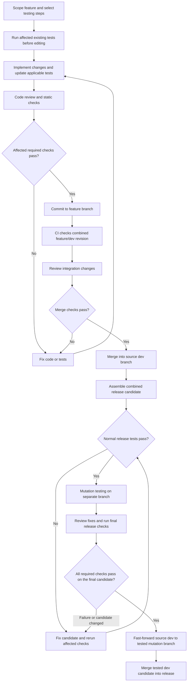

# Testing workflow

## Inputs

- Project requirements, acceptance criteria, and relevant load targets.
- Change diff, affected modules, callers, contracts, and shared libraries.
- Existing tests, commands, fixtures, environments, and configured gates.

## Testing steps

Select applicable checks when scoping the feature. A required check must pass at each gate below; an inapplicable step needs a recorded reason. CI repeats automated checks; browser checks and review also need evidence tied to the candidate.

| Step | During feature work | Before every commit | Before merging into dev | Before release |
|---|---|---|---|---|
| [Unit tests](unit-tests.md) | Add tests for changed logic; reproduce bugs before fixing | Run affected modules and shared-code consumers | CI reruns on the combined feature/dev revision | Run the full configured unit suite on the final candidate |
| [Integration tests](integration-tests.md) | Add checks for changed storage and service interactions | Run affected interactions with real test dependencies | CI verifies affected interactions on the combined revision | Run configured release interactions, including migrations where applicable |
| [Contract tests](contract-tests.md) | Check API changes and affected providers/consumers | Run affected compatibility and behavior checks | CI checks the combined contracts and consumers | Verify supported client/server versions on the final candidate |
| [End-to-end tests](end-to-end-tests.md) | Add or update checks for changed critical flows | Run affected critical flows | CI reruns affected flows against the assembled application | Run the critical smoke suite with candidate images and configuration |
| [UI tests](ui-tests.md) | Check changed interactions, states, accessibility, and layouts | Verify affected browser flows and review visual changes | Repeat automated checks; refresh browser checks if merging changes the UI | Verify required flows, browsers, and screen sizes on the final candidate |
| [Performance tests](performance-tests.md) | Establish baseline and workload for affected load targets | Verify affected targets where required | Check the combined revision if integration affects those targets | Run required workloads and compare with the baseline |
| [Mutation testing](mutation-testing.md) | Build normal test coverage | Normal checks for any test improvements or fixes | Normal checks; mutation testing runs at the release stage | After combining dev branches and passing normal tests, run on the mutation branch; merge back only after final checks pass |
| [Static checks](static-checks.md) | Use formatter, lint, type, and build feedback while editing | Run all affected required checks | CI repeats them on the combined revision | Run configured release checks, including builds and generated-code checks |
| [Code review](code-review.md) | Trace changed behavior, callers, and test expectations | Resolve correctness and required-coverage findings | Review integration changes and conflict resolutions | Review combined changes and any mutation-stage fixes before final checks |

## Flow

## During feature work

1. Map changed behavior and affected callers to the required steps above. Missing requirements block checks that depend on them.
2. Run existing tests for the affected scope before editing. Record existing failures separately; they do not count as passes.
3. Add or update applicable unit, integration, contract, end-to-end, UI, and performance tests as the behavior changes. Use the individual step plans for details.

## Before every commit

1. Review the diff and connected code. Resolve correctness and required-coverage findings.
2. Run affected unit tests, consumers of shared code, static checks, and applicable integration, contract, end-to-end, UI, and performance checks.
3. Test the exact content being committed; partial staging must not depend on unstaged changes. Commit only after required checks pass. This gate also applies to commits on mutation-testing branches.

## Before merging into dev

1. Test the combined feature/dev revision with the same automated commands in CI. Passing feature-branch results alone do not validate the merge.
2. Review integration changes and conflict resolutions. Refresh affected manual UI or performance checks if the combined revision changes their results.
3. Merge only after required checks pass. If dev advances, validate the updated combined revision.

## Before release

1. Integrate dev branches into a chosen dev branch. Separate passing runs do not validate the combined candidate.
2. Create the mutation-testing branch and verify normal release tests pass before mutation. Complete mutation testing using its individual plan.
3. Review integration changes and mutation-stage fixes. Run the full configured release suite on the final candidate: unit, integration, contract, critical end-to-end, static checks, and required UI and performance checks.
4. Require passing CI results and other required evidence for the candidate, then fast-forward the source dev branch to the tested mutation branch and merge the tested dev candidate into `release`.
5. New commits, integration changes, or conflict resolutions invalidate affected results and require reruns before merge-back or release.

## Shared execution rules

- Setup records each check's command, scope, environment, and blocking status. Required CI checks enforce the merge gates.
- Use isolated test data and services, pinned dependencies and images, and repeatable fixture setup and cleanup.
- Failed, skipped, unavailable, or unexpectedly empty required checks block the gate. Distinguish product failures from environment or tool failures.
- Keep the first failure visible. Diagnostic retries do not erase it. Intermittent failures need investigation; exclusions require a reason, owner, and expiry and must leave the required behavior covered.
- Record source branch, tested revision or diff, commands, environment versions, results, and exclusions. Preserve failure logs and relevant test artifacts.

## Done

- Acceptance criteria have passing checks.
- Required checks pass on the final candidate; failures, skipped checks, and unavailable environments remain visible.
- All applicable testing steps meet their gates on the final candidate.
- Review has no unresolved correctness findings.
- Report the tested revision or diff, commands, results, and remaining limits. Passing local tests does not establish deployed behavior.

## To decide before implementation

- Commands, environments, and CI gates for each supported stack.
- Critical application flows and required release suite.
- Mutation tools, threshold, and allowed exclusions; performance targets where applicable.
